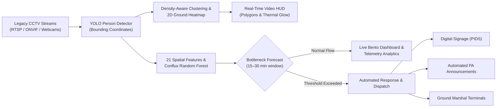

<div align="center">

# Vigilo

### Predictive AI Pedestrian Crowd Intelligence & Flow Management

**Powered by the Conflux Model & YOLO Vision**

[](https://nextjs.org)
[](https://react.dev)
[](https://fastapi.tiangolo.com)
[](https://www.docker.com)
[](https://tailwindcss.com)
[](https://github.com/oframe/ogl)
[](https://www.typescriptlang.org)

<p align="center">
  <a href="#overview">Overview</a> •
  <a href="#key-capabilities">Key Capabilities</a> •
  <a href="#density-aware-spatial-clustering">Spatial Clustering</a> •
  <a href="#system-architecture">System Architecture</a> •
  <a href="#target-deployments">Target Deployments</a> •
  <a href="#visual-computing--shaders">Visual Computing</a> •
  <a href="#tech-stack">Tech Stack</a> •
  <a href="#getting-started">Getting Started</a> •
  <a href="#docker-deployment">Docker Deployment</a> •
  <a href="#project-structure">Project Structure</a> •
  <a href="#roadmap">Roadmap</a>
</p>

</div>

---

## Overview

**Vigilo** is a high-throughput pedestrian crowd intelligence and predictive flow management platform engineered for complex transit hubs, airports, urban centers, and mega-event venues.

Rather than reacting to hazardous stampedes, surges, and congestion after thresholds are crossed, Vigilo leverages existing optical surveillance infrastructure to forecast bottlenecks **15–30 minutes in advance** using the **Conflux spatiotemporal model**—all while preserving commuter privacy through biometric-free computer vision.

> **Privacy First**: Vigilo operates on optical mass density, cluster geometry, and directional flow vectoring. It stores zero facial signatures, biometric templates, or persistent tracking identifiers.

---

## Key Capabilities

| Capability | Description |
| :--- | :--- |
| **Legacy CCTV Ingestion** | Ingests native RTSP & ONVIF video streams without requiring costly hardware retrofits or proprietary sensor pods. |
| **Density-Aware Spatial Clustering** | Perspective-adaptive graph clustering partitioning crowds into high-density cluster polygons ($\ge 6$), gatherings ($3–5$), and isolated pedestrians. |
| **Dynamic 2D Ground Heatmap** | Continuous Gaussian thermal density glow projected at floor contact points using `COLORMAP_TURBO` with real-time HUD toggles. |
| **Predictive Neural Flow** | Spatiotemporal neural modeling forecasting congestion chokepoints 15–30 minutes before critical escalation occurs. |
| **Biometric-Free Privacy** | Fully compliant with global privacy frameworks (GDPR, CCPA) using optical mass density and flow vectors with zero facial recognition. |
| **All-in-One Docker Container** | Production-ready single-container deployment unifying the Next.js UI and FastAPI AI engine behind a single port (`3000`). |
| **Hardware-Accelerated Visuals** | Real-time WebGL shader pipelines powered by `ogl` providing fluid spatial dynamics and visual density simulation. |

---

## Density-Aware Spatial Clustering

Vigilo incorporates a multi-layer spatial clustering and thermal density engine:

1. **Perspective-Adaptive Proximity**: Proximity threshold scales dynamically with pedestrian height in frame ($D_{\text{thresh}} = \bar{h} \times 0.85$) based on ground foot contact points $\left(\frac{x_1 + x_2}{2}, y_2\right)$.
2. **Graph Connected Components**: Fast BFS graph partitioning:
   * **Dense Crowd Zones ($\ge 6$ people)**: Rendered with translucent crimson convex hull polygons, perimeter contour lines, and `crowd_density_high` badges.
   * **Abnormal Gatherings ($3–5$ people)**: Rendered with royal blue bounding boxes, translucent fill, and `abnormal_gathering` badges.
   * **Isolated Pedestrians**: High-tech cyber corner brackets and individual confidence tags.
3. **2D Ground Density Heatmap**: Downsampled $4\times$ ($<1.5\text{ms}$) floor-level Gaussian thermal field smoothly blended over walking corridors.
4. **Live HUD Controls**: Interactive Liquid Glass toggles directly on the video monitor to enable/disable heatmaps and cluster polygons in real time.

---

## System Architecture

Vigilo unifies passive optical sensors with predictive AI and automated dispatch triggers:



---

## Target Deployments

* **Railway Terminals**: Platform surge containment, footbridge flow regulation, timetable-driven crowd pacing, and transfer tunnel balancing.
* **Metro Stations**: Concourse choke-point alleviation, turnstile throughput balancing, emergency egress routing, and stairway metering.
* **Airports**: Security checkpoint queue mitigation, customs hall throughput, baggage claim zone distribution, and terminal transit pacing.
* **Shopping Malls**: Multi-level atrium bottleneck elimination, retail footfall analytics, and escalator safety pacing.
* **Mega Events & Stadiums**: Turnstile pressure relief, perimeter crowd guidance, and rapid emergency egress coordination.

---

## Visual Computing & Shaders

Vigilo incorporates a custom hardware-accelerated WebGL rendering pipeline built on [`ogl`](https://github.com/oframe/ogl):

* **`UiloraCloudBackground`**: Custom domain-warped fractional Brownian motion (fBm) shader simulating atmospheric crowd pressure distributions and fluid dynamics on the hero landing page.
* **`UiloraLiquidChrome`**: GPU-driven simplex noise simulation representing molten metallic density surfaces with interactive mouse wake distortion, viscosity modeling, and frame-pause state controls on the dashboard.
* **macOS Liquid Glass UI**: Custom backdrop filter shaders (`blur(28px) saturate(210%)`) with top-edge specular curvature reflections, dark translucent inner cards, and hover-triggered shimmer sweeps.

---

## Tech Stack

* **Frontend Framework**: [Next.js](https://nextjs.org) 16 (App Router, Turbopack, Standalone Output)
* **Frontend Library**: [React](https://react.dev) 19
* **Styling**: [Tailwind CSS](https://tailwindcss.com) v4
* **Graphics & Shaders**: WebGL via [`ogl`](https://github.com/oframe/ogl)
* **Backend & Stream API**: [FastAPI](https://fastapi.tiangolo.com) & [Uvicorn](https://www.uvicorn.org) (Python 3.12+)
* **Computer Vision & Inference**: [Ultralytics YOLO](https://docs.ultralytics.com), [scikit-learn](https://scikit-learn.org) Random Forest, OpenCV
* **Containerization**: [Docker](https://www.docker.com) multi-stage builds & [Docker Compose](https://docs.docker.com/compose/)
* **Typography**: [Geist Sans & Geist Mono](https://vercel.com/font)
* **Language**: [TypeScript](https://www.typescriptlang.org) 5 & Python 3

---

## Getting Started

### Local Development (Without Docker)

#### Prerequisites
* **Node.js**: `20.x` or higher
* **Package Manager**: `npm`, `pnpm`, or `yarn`
* **Python**: `3.10` or higher (with `pip` and virtual environment support)
* **Video Device**: Integrated/external webcam (default: index `0`), RTSP IP camera, or test video file

#### 1. Clone & Install Frontend
```bash
git clone https://github.com/kodo-kaze/vigilo.git
cd vigilo
npm install
```

#### 2. Install Backend Dependencies
```bash
# Discover or create virtual environment in backend/
python3 -m venv backend/.venv
source backend/.venv/bin/activate
pip install -r backend/requirements.txt
```

#### 3. Run Both Services Concurrently

* **Terminal 1 (Backend AI Engine)**:
  ```bash
  npm run backend
  # Or: bash backend/start.sh
  ```
* **Terminal 2 (Next.js Frontend)**:
  ```bash
  npm run dev
  ```

Open [http://localhost:3000/dashboard](http://localhost:3000/dashboard) to view the live dashboard.

---

## Docker Deployment (All-in-One Container)

Vigilo includes a production-ready, multi-stage **All-in-One Docker container** that bundles both the Next.js frontend and the Python AI backend into a single image, accessible via a **single port (`3000`)** with zero CORS configuration.

### Option A: Docker Compose (Recommended)

```bash
# Start the all-in-one container in background
docker compose up -d

# View live logs
docker compose logs -f
```

### Option B: Docker CLI Build & Run

1. **Build the Image**:
   ```bash
   docker build -t vigilo:latest .
   ```

2. **Run with Network RTSP Stream**:
   ```bash
   docker run -d \
     --name vigilo \
     -p 3000:3000 \
     -e CROWD_STREAM_SOURCE="rtsp://192.168.1.100:554/live" \
     vigilo:latest
   ```

3. **Run with Local USB / Laptop Webcam (Linux)**:
   ```bash
   docker run -it --rm \
     --name vigilo \
     -p 3000:3000 \
     --device /dev/video0:/dev/video0 \
     -e CROWD_STREAM_SOURCE="0" \
     vigilo:latest
   ```

4. **Run with NVIDIA GPU Acceleration (Optional)**:
   ```bash
   docker run -d \
     --name vigilo \
     --gpus all \
     -p 3000:3000 \
     vigilo:latest
   ```

Open [http://localhost:3000](http://localhost:3000) in your browser. Both the web UI and all telemetry/video streams are served through port `3000`.

---

## Available Scripts

| Command | Description |
| :--- | :--- |
| `npm run dev` | Starts the Next.js development server with Turbopack on `http://localhost:3000`. |
| `npm run backend` | Boots the FastAPI CCTV & YOLO inference streaming backend on `http://localhost:8000`. |
| `npm run build` | Compiles and optimizes the Next.js frontend with standalone output for production. |
| `npm run start` | Serves the compiled production build locally. |
| `npm run lint` | Runs ESLint checks across TypeScript and React source files. |

---

## Project Structure

```text
vigilo/
├── app/
│   ├── about/                    # About & documentation page
│   ├── dashboard/
│   │   └── page.tsx              # Live CCTV monitor, bento telemetry cards & liquid shader
│   ├── globals.css               # Global styles, Tailwind v4 theme, macOS Liquid Glass
│   ├── layout.tsx                # Root layout with Geist font configurations & metadata
│   ├── template.tsx              # Cinematic blur-focus page transitions
│   └── page.tsx                  # Landing page hero with UiloraCloudBackground
├── backend/
│   ├── config.py                 # Backend runtime settings, thresholds, and model paths
│   ├── detector.py               # YOLO object detector, 2D ground heatmap & spatial clustering
│   ├── main.py                   # FastAPI REST API, MJPEG video feed, display options & power toggles
│   ├── model/                    # Trained weights (best.pt, crowd_random_forest_v1.pkl)
│   ├── requirements.txt          # Python dependencies (PyTorch, Ultralytics, OpenCV, etc.)
│   ├── start.sh                  # Virtualenv discovery and backend launcher script
│   └── stream.py                 # Multi-threaded camera frame grabber & broadcaster
├── src/
│   └── components/
│       ├── ui/                   # Reusable Liquid Glass design system
│       │   ├── LiquidGlassCard.tsx   # Translucent specular glass cards
│       │   ├── LiquidInnerCard.tsx   # Darker translucent inner telemetry containers
│       │   ├── LiquidGlassButton.tsx # Pill & circular liquid glass buttons
│       │   ├── LiquidPill.tsx        # Specular status badges with solid steady dots
│       │   ├── GlassInput.tsx        # Translucent dark form inputs
│       │   ├── LiquidNavMenu.tsx     # Circular speed dial floating navigation menu
│       │   ├── UiloraCloudBackground.tsx # WebGL domain-warping cloud shader
│       │   └── UiloraLiquidChrome.tsx    # WebGL molten chrome flow shader
│       └── dashboard/            # Modular dashboard domain components
│           ├── CameraDetailsCard.tsx     # CCTV hardware telemetry & auto-start toggle
│           ├── CrowdDynamicsCard.tsx     # 6-tile spatial density & cluster telemetry
│           ├── DashboardVideoFeed.tsx    # Live MJPEG stream display with HUD toggles
│           ├── CameraSourceModal.tsx     # Stream switcher dialog container
│           ├── CameraNetworkStreamTab.tsx# IP/Port & RTSP configuration tab
│           ├── CameraPresetsTab.tsx      # Optical hardware & facility CCTV grid tab
│           ├── CameraCustomUriTab.tsx    # Direct stream endpoint & video file tab
│           ├── CameraSourceNodeCard.tsx  # Preset optical sensor tile
│           └── TelemetryMetricTile.tsx   # Aesthetic high-contrast metric component
├── Dockerfile                    # Multi-stage production container definition
├── docker-compose.yml            # Container orchestration specification
├── entrypoint.sh                 # Container dual-process supervisor script
├── .dockerignore                 # Excludes caches and local dependencies from build context
├── next.config.ts                # Next.js standalone output & API proxy rewrites
├── package.json                  # Frontend scripts & dependencies
├── tsconfig.json                 # TypeScript compiler configurations
└── README.md                     # Project documentation
```

---

## Roadmap

- [x] High-performance WebGL ambient fluid & molten chrome shaders
- [x] Minimalist landing experience with macOS liquid glass UI components
- [x] Interactive shader controls (play/pause toggle, mouse wake physics)
- [x] RTSP / ONVIF camera stream ingestion service & simulated feeds
- [x] Conflux inference worker integration with density heatmaps & perspective graph clustering
- [x] Decoupled modular UI component architecture with dark inner glass
- [x] All-in-one unified Docker container deployment
- [ ] Real-time incident alert dispatching & digital signage webhook triggers
- [ ] Multi-zone transit station topology configuration editor

---

## License

Private & Proprietary. All rights reserved.
