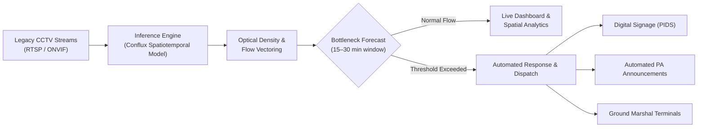

<div align="center">

# Vigilo

### Predictive AI Pedestrian Crowd Intelligence & Flow Management

**Powered by the Conflux Model**

[](https://nextjs.org)
[](https://react.dev)
[](https://tailwindcss.com)
[](https://github.com/oframe/ogl)
[](https://www.typescriptlang.org)

<p align="center">
  <a href="#overview">Overview</a> •
  <a href="#key-capabilities">Key Capabilities</a> •
  <a href="#system-architecture">System Architecture</a> •
  <a href="#target-deployments">Target Deployments</a> •
  <a href="#visual-computing--shaders">Visual Computing</a> •
  <a href="#tech-stack">Tech Stack</a> •
  <a href="#getting-started">Getting Started</a> •
  <a href="#project-structure">Project Structure</a> •
  <a href="#roadmap">Roadmap</a>
</p>

</div>

---

## Overview

**Vigilo** is a high-throughput pedestrian crowd intelligence and predictive flow management platform engineered for complex transit hubs, airports, urban centers, and mega-event venues.

Rather than reacting to hazardous stampedes, surges, and congestion after thresholds are crossed, Vigilo leverages existing optical surveillance infrastructure to forecast bottlenecks **15–30 minutes in advance** using the **Conflux spatiotemporal model**—all while preserving commuter privacy through biometric-free computer vision.

> **Privacy First**: Vigilo operates on optical density estimation and directional flow vectoring. It stores zero facial signatures, PII, or persistent tracking identifiers.

---

## Key Capabilities

| Capability | Description |
| :--- | :--- |
| **Legacy CCTV Ingestion** | Ingests native RTSP & ONVIF video streams without requiring costly hardware retrofits or proprietary sensor pods. |
| **Predictive Neural Flow** | Spatiotemporal neural modeling forecasting congestion chokepoints 15–30 minutes before critical escalation occurs. |
| **Biometric-Free Privacy** | Fully compliant with global privacy frameworks (GDPR, CCPA) using optical mass density and flow vectors with zero facial recognition. |
| **Closed-Loop Coordination** | Integrates directly with digital passenger displays (PIDS), automated PA announcement systems, and marshal dispatch terminals. |
| **Hardware-Accelerated Visuals** | Real-time WebGL shader pipelines powered by `ogl` providing fluid spatial dynamics and visual density simulation. |

---

## System Architecture

Vigilo unifies passive optical sensors with predictive AI and automated dispatch triggers:



---

## Target Deployments

* **Railway Terminals**: Platform surge containment, footbridge flow regulation, timetable-driven crowd pacing, and transfer tunnel balancing.
* **Metro Stations**: Concourse choke-point alleviation, turnstile throughput balancing, emergency egress routing, and stairway metering.
* **Airports**: Security checkpoint queue mitigation, customs hall throughput, baggage claim zone distribution, and terminal transit pacing.
* **Shopping Malls**: Multi-level atrium bottleneck elimination, retail footfall analytics, and escalator safety pacing.
* **Mega Events & Stadiums**: Turnstile pressure relief, perimeter crowd guidance, and rapid emergency egress coordination.

---

## Visual Computing & Shaders

Vigilo incorporates a custom hardware-accelerated WebGL rendering pipeline built on [`ogl`](https://github.com/oframe/ogl):

* **`UiloraCloudBackground`**: Custom domain-warped fractional Brownian motion (fBm) shader simulating atmospheric crowd pressure distributions and fluid dynamics on the hero landing page.
* **`UiloraLiquidChrome`**: GPU-driven simplex noise simulation representing molten metallic density surfaces with interactive mouse wake distortion, viscosity modeling, and frame-pause state controls on the dashboard.
* **macOS Liquid Glass UI**: Custom backdrop filter shaders (`blur(28px) saturate(210%)`) with top-edge specular curvature reflections and hover-triggered shimmer sweeps.

---

## Tech Stack

* **Frontend Framework**: [Next.js](https://nextjs.org) 16 (App Router, Turbopack)
* **Frontend Library**: [React](https://react.dev) 19
* **Styling**: [Tailwind CSS](https://tailwindcss.com) v4
* **Graphics & Shaders**: WebGL via [`ogl`](https://github.com/oframe/ogl)
* **Backend & Stream API**: [FastAPI](https://fastapi.tiangolo.com) & [Uvicorn](https://www.uvicorn.org) (Python 3.9+)
* **Computer Vision & Inference**: [Ultralytics YOLO](https://docs.ultralytics.com), [scikit-learn](https://scikit-learn.org) Random Forest, OpenCV
* **Typography**: [Geist Sans & Geist Mono](https://vercel.com/font)
* **Language**: [TypeScript](https://www.typescriptlang.org) 5 & Python 3

---

## Getting Started

### Prerequisites

* **Node.js**: `20.x` or higher
* **Package Manager**: `npm`, `pnpm`, or `yarn`
* **Python**: `3.9` or higher (with `pip` and virtual environment support)
* **Video Ingestion Device**: Integrated/external webcam (default: index `0`), or RTSP/video file source

### Installation

1. **Clone the repository:**
   ```bash
   git clone https://github.com/your-username/vigilo.git
   cd vigilo
   ```

2. **Install frontend dependencies:**
   ```bash
   npm install
   ```

3. **Install Python backend dependencies:**
   ```bash
   # Set up a virtual environment in backend/ (start.sh detects .venv, venv, or system python3)
   python3 -m venv backend/.venv
   source backend/.venv/bin/activate
   pip install -r backend/requirements.txt
   ```

---

### Running the Application

Vigilo consists of two decoupled services: the **Python AI Streaming Backend** (port `8000`) and the **Next.js Web UI** (port `3000`). Both must run concurrently.

#### Step 1: Start the AI Vision Backend
Open your first terminal and run:
```bash
npm run backend
```
*(Or directly: `bash backend/start.sh`)*

> [!NOTE]
> By default, the backend boots into **Standby Mode** (camera suspended for energy conservation) until toggled on in the UI.
>
> * **Auto-Start Camera on Boot**:
>   ```bash
>   npm run backend -- --auto-start
>   ```
> * **Runtime Camera Selection (Recommended)**:
>   You no longer need to pass `--source` when running the backend! You can switch cameras and connect directly to any IP camera by entering its **IP Address and Port Number** in real-time from the dashboard UI.
> * **CLI Override (Optional)**:
>   ```bash
>   npm run backend -- --source "rtsp://camera-ip:554/live"
>   # or stream a recorded video file:
>   npm run backend -- --source "path/to/cctv_sample.mp4"
>   ```

#### Step 2: Start the Next.js Frontend
Open a second terminal and run:
```bash
npm run dev
```

#### Step 3: Open the Dashboard & Select Camera
1. Navigate to [http://localhost:3000/dashboard](http://localhost:3000/dashboard).
2. Click the **Camera / Switch Node** button on the CCTV monitor card or the **Change** action under Optical Sensor.
3. Choose your ingestion interface:
   * **Network IP & Port**: Enter the camera's IP Address (e.g. `192.168.1.100`) and Port Number (`554` for RTSP, `8080` for HTTP), select protocol, and click **Connect & Stream**.
   * **Interfaces & Presets**: Switch instantly between local hardware sensors (Integrated Webcam 0, USB Webcam 1) or pre-configured facility CCTV nodes.
   * **Direct URI**: Provide any full RTSP stream or looping video clip.
4. Click the **Power** button to toggle camera capture and neural inference on demand.

---

### Available Scripts

| Command | Description |
| :--- | :--- |
| `npm run dev` | Starts the Next.js development server with Turbopack on `http://localhost:3000`. |
| `npm run backend` | Boots the FastAPI CCTV & YOLO inference streaming backend on `http://localhost:8000`. |
| `npm run build` | Compiles and optimizes the Next.js frontend for production. |
| `npm run start` | Serves the compiled production build. |
| `npm run lint` | Runs ESLint checks across TypeScript and React source files. |

---

## Project Structure

```text
vigilo/
├── app/
│   ├── about/                    # About & documentation page
│   ├── dashboard/
│   │   └── page.tsx              # Live CCTV monitor, telemetry cards & liquid shader
│   ├── globals.css               # Global styles, Tailwind v4 theme, macOS Liquid Glass
│   ├── layout.tsx                # Root layout with Geist font configurations & metadata
│   └── page.tsx                  # Landing page hero with UiloraCloudBackground
├── backend/
│   ├── config.py                 # Backend runtime settings, thresholds, and model paths
│   ├── detector.py               # YOLO object detector & 21-feature Random Forest engine
│   ├── main.py                   # FastAPI REST API, MJPEG video feed, & power toggles
│   ├── model/                    # Trained weights (best.pt, crowd_random_forest_v1.pkl)
│   ├── requirements.txt          # Python dependencies (PyTorch, Ultralytics, OpenCV, etc.)
│   ├── start.sh                  # Virtualenv discovery and backend launcher script
│   └── stream.py                 # Multi-threaded camera frame grabber & broadcaster
├── public/                       # Static public assets and SVGs
├── src/
│   └── components/
│       └── ui/
│           ├── CameraDetailsCard.tsx     # CCTV hardware telemetry & auto-start toggle
│           ├── CrowdDynamicsCard.tsx     # Spatial density, neighbor distance & alert status
│           ├── DashboardVideoFeed.tsx    # Live MJPEG stream display & HUD overlays
│           ├── LiquidNavMenu.tsx         # macOS glass floating navigation bar
│           ├── UiloraCloudBackground.tsx # WebGL domain-warping cloud shader
│           └── UiloraLiquidChrome.tsx    # WebGL molten chrome flow shader
├── package.json                  # Frontend scripts & dependencies
├── tsconfig.json                 # TypeScript compiler configurations
└── README.md                     # Project documentation
```

---

## Roadmap

- [x] High-performance WebGL ambient fluid & molten chrome shaders
- [x] Minimalist landing experience with macOS liquid glass UI components
- [x] Interactive shader controls (play/pause toggle, mouse wake physics)
- [ ] RTSP / ONVIF camera stream ingestion service & simulated feeds
- [ ] Conflux inference worker integration with density heatmaps
- [ ] Real-time incident alert dispatching & digital signage webhook triggers
- [ ] Multi-zone transit station topology configuration editor

---

## License

Private & Proprietary. All rights reserved.
